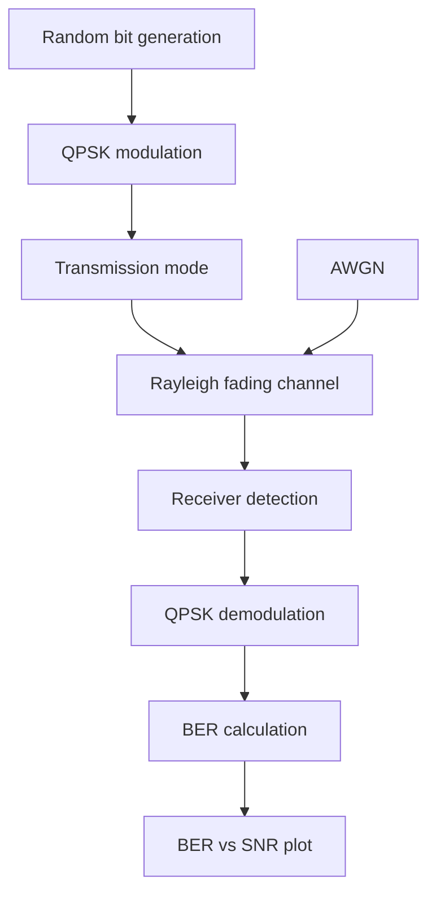
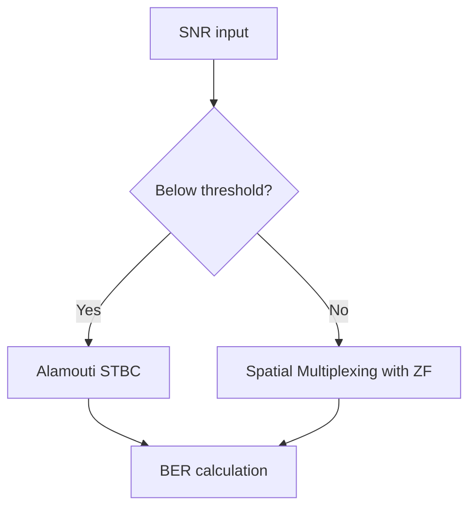

<h1 align="center">WiFi MIMO Simulation</h1>

<strong>Performance Analysis of Wireless Communication Systems using MATLAB</strong>

  
  
  
  

  <a href="#overview">Overview</a> • <a href="#simulation-model">Simulation Model</a> • <a href="#implemented-techniques">Techniques</a> • <a href="#getting-started">Getting Started</a> • <a href="#evaluation">Evaluation</a>

Overview
An academic MATLAB project investigating the performance of WiFi-inspired multiple-input multiple-output (MIMO) communication systems. The simulations use QPSK modulation, Rayleigh fading and additive white Gaussian noise (AWGN) to study bit error rate (BER) as a function of signal-to-noise ratio (SNR).

The project explores the trade-off between transmission reliability and spatial multiplexing gain. It models a simplified baseband link rather than a complete IEEE 802.11 protocol stack.
Features
- SISO reference simulation with channel equalization.
- Alamouti space-time block coding (STBC) with two transmit antennas.
- Spatial multiplexing with MMSE detection.
- SNR-based adaptive switching between diversity and spatial multiplexing.
- Configurable antenna counts and SNR ranges in the multiplexing scripts.
- BER calculation and logarithmic BER-versus-SNR plots.
Simulation Model

The baseband MIMO model is y = Hx + n, where H is the complex channel matrix, x is the transmitted signal vector and n is additive noise. The receiver uses the simulated channel coefficients directly.
Implemented Techniques
Mode	Default antenna configuration	Receiver	Purpose
SISO	1 × 1	Zero-Forcing equalization	Reference baseline
Spatial Diversity	2 × 1	Alamouti combining	Improve reliability
Spatial Multiplexing	2 × 2	MMSE	Explore parallel spatial streams
Adaptive MIMO	2 × 2	Alamouti / Zero-Forcing	Switch modes according to SNR

Adaptive Mode Selection

The default switching threshold is 10 dB. This is a configurable simulation parameter, not an experimentally optimized threshold.
Simulation Parameters
Parameter	Default
Modulation	QPSK
Channel	Rayleigh fading
Noise	AWGN
SNR range	0:2:20 dB
SISO and diversity bit count	1,000,000
Multiplexing input parameter N	100,000
Adaptive bit count	100,000
Adaptive threshold	10 dB

Repository Structure
.
├── SISO.m                  # SISO baseline
├── Dirversity.m            # Alamouti STBC simulation
├── Spatial Multiplexing.m  # MMSE spatial multiplexing
├── Adaptive.m              # SNR-based mode switching
├── BAOCAO_CDDTVT.docx       # Academic report (optional)
└── README.md
File names match the supplied source archive.
Getting Started
Requirements
- MATLAB with standard numerical and plotting functions.
- No external datasets are required.
Run the simulations
Open the project directory in MATLAB and execute one of the following commands in the Command Window:
run('SISO.m')
run('Dirversity.m')
run('Spatial Multiplexing.m')
run('Adaptive.m')
Run each script separately. For the interactive scripts, press Enter to accept default parameters. Keep two transmit antennas for the adaptive script when using its Alamouti branch. Use compatible bit counts and antenna dimensions so that complete symbol blocks can be formed.
Evaluation
Each script generates a BER-versus-SNR plot using a logarithmic BER axis. The academic report discusses the reliability benefits of diversity and the throughput motivation for spatial multiplexing.

For reproducible quantitative comparisons, further work is needed to align total transmit power, channel assumptions, bit accounting and random seeds across all modes. Throughput is not directly measured by the supplied scripts.
Limitations and Future Work
- Standardize transmit-power normalization across all modes.
- Review MMSE regularization against the transmit-power model.
- Validate adaptive antenna dimensions and account for incomplete symbol blocks.
- Add reproducible random seeds and a combined comparison script.
- Evaluate throughput and optimize the adaptive switching threshold.
- Extend the simplified baseband model with OFDM and channel estimation.
Academic Context
Course: Electronics and Telecommunications Special Topics (Chuyên đề Điện tử - Viễn thông)
Institution: Ho Chi Minh City University of Technology (HCMUT)
Project: Analysis and Simulation of WiFi MIMO Systems
Team: Group 03, Class L01, Semester 252

This repository documents a group academic project for educational and research purposes.
